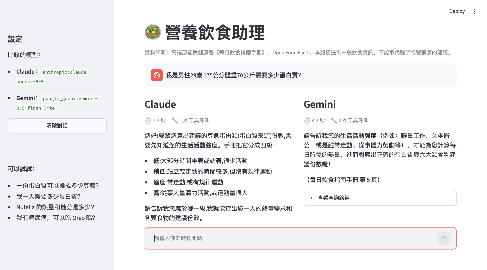
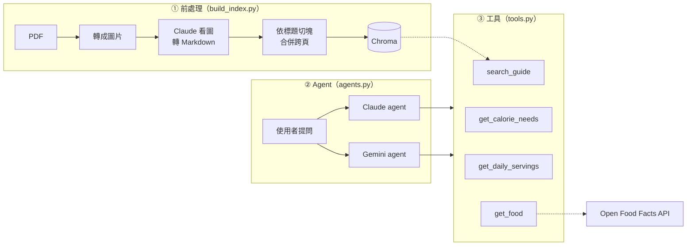

# 🥗 營養飲食助理

結合 **PDF 飲食指南**與**開放食品資料庫 API** 的 Agentic RAG 專案，使用 LangChain 讓 **Claude 和 Gemini 同時回答**同一個問題，並排比較兩個模型的回答與查詢路徑。

> 本專案提供一般飲食資訊，不能取代醫師或營養師的建議。



## 功能

- **PDF 前處理**：用 Claude 看圖，把含大量表格的 PDF 轉成乾淨的 Markdown，再依標題切塊、合併跨頁內容
- **RAG 檢索**：搜尋衛福部國民健康署《每日飲食指南手冊》
- **精確查表**：依性別、年齡、活動強度查熱量需求，再依熱量查六大類建議份數
- **外部 API**：查詢 Open Food Facts 的市售食品營養成分，含快取與錯誤處理
- **雙模型比較**：Claude 與 Gemini 平行回答，顯示花費時間、工具呼叫次數與查詢路徑
- **多輪對話**：資訊不足時，模型會先詢問使用者，並記得之前的對話

## 架構



| 工具 | 資料來源 | 用途 |
|---|---|---|
| `search_guide` | 飲食指南手冊（Chroma） | 飲食原則、營養知識、份量代換 |
| `get_calorie_needs` | 手冊表三 | 依性別、年齡、活動強度查每日熱量需求 |
| `get_daily_servings` | 手冊表四 | 依熱量查六大類飲食建議份數 |
| `get_food` | Open Food Facts API | 用條碼或名稱查市售食品營養成分 |

## 使用技術

| 用途 | 工具 |
|---|---|
| Agent 框架 | LangChain（`create_agent`、`@tool`） |
| 語言模型 | Claude、Gemini |
| PDF 處理 | PyMuPDF + Claude 多模態 |
| Embedding | `BAAI/bge-small-zh-v1.5` |
| 向量資料庫 | Chroma |
| 外部 API | Open Food Facts |
| 網頁介面 | Streamlit |

## 專案結構

```
nutrition-assistant/
├── data/
│   ├── daily_food_guide.pdf   # 每日飲食指南手冊
│   └── pages/                 # Claude 轉換後的 Markdown（每頁一個檔案）
├── config.py                  # 設定：路徑、模型名稱、User-Agent
├── tables.py                  # 手冊表三、表四的數據
├── build_index.py             # 前處理：PDF → Markdown → 切塊 → 索引
├── tools.py                   # agent 使用的 4 個工具
├── agents.py                  # 系統提示詞、建立 agent、平行執行
├── app.py                     # Streamlit 網頁介面
├── nutrition.ipynb            # 開發過程的 notebook
├── requirements.txt
└── .env                       # API 金鑰（不上傳）
```

檔案之間的依賴關係：

```
app.py → agents.py → tools.py → build_index.py → config.py、tables.py
```

## 安裝與執行

**1. 建立環境**

```bash
conda create -n rag python=3.11 -y
conda activate rag
pip install -r requirements.txt
```

**2. 設定 API 金鑰**

在專案根目錄建立 `.env`：

```
ANTHROPIC_API_KEY=你的 Anthropic 金鑰
GOOGLE_API_KEY=你的 Google AI Studio 金鑰
```

並在 `config.py` 將 `OFF_USER_AGENT` 的 email 改成自己的（Open Food Facts 規定需附聯絡方式）。

**3. 建立索引**

```bash
python build_index.py
```

第一次執行會用 Claude 轉換 PDF 的每一頁，之後已轉換的頁面會自動跳過。

**4. 測試**

```bash
python tools.py     # 測試 4 個工具
python agents.py    # 測試兩個模型
```

**5. 啟動網頁**

```bash
streamlit run app.py
```

## 設定

模型名稱集中在 `config.py`，新增或更換模型只要修改這裡，介面會自動多出一欄：

```python
AGENT_MODELS = {
    "Claude": "anthropic:claude-sonnet-5-5",
    "Gemini": "google_genai:gemini-3.5-flash-lite",
}
```

模型名稱更新頻繁，請以各家官方文件為準。

## 開發過程學到的事

- **PDF 的表格是 RAG 最難處理的部分**：`pypdf` 只讀得到文字和座標，表格會被攤平。改用多模態模型看圖轉換，效果好很多
- **精確的查詢用程式，模糊的語意用檢索**：embedding 分不清「1800 大卡」和「2000 大卡」，表格改做成查表工具
- **工具要讓模型分辨「沒有資料」和「暫時拿不到資料」**：否則服務暫時中斷時，模型會告訴使用者「沒有這個產品」
- **工具的說明和回傳內容，決定模型會怎麼回答**：要寫清楚用途、限制、單位，並說明做了哪些轉換
- **不同模型有不同的個性**：同樣的工具和提示詞，Claude 較保守、會說明假設；Gemini 較快、較主動。並排比較能看清楚各自的取捨

## 資料來源

- 衛生福利部國民健康署《每日飲食指南手冊》
- [Open Food Facts](https://world.openfoodfacts.org)：開放食品資料庫，資料以 Open Database License 授權
